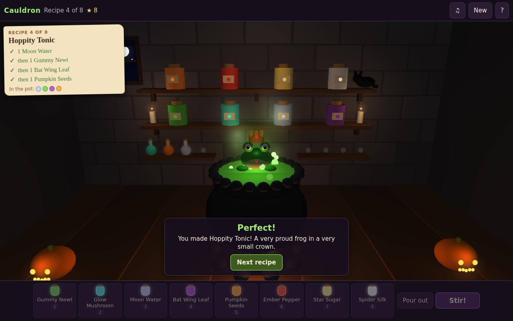
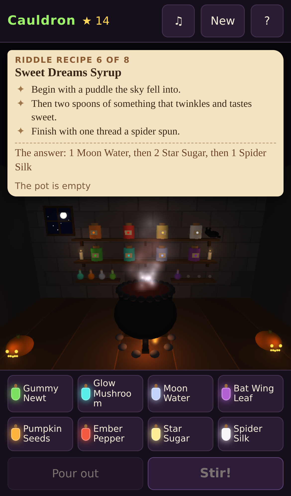

# Cauldron

A small, cozy Halloween potion-brewing game on the [Strata](https://github.com/Preponderous-Software/strata) engine.



**Play it in the browser:** https://cauldron.play.danielstephenson.dev (desktop and phone).

It's Halloween night in the cottage and the potion book is open. Each recipe card asks for a potion: drop the
ingredients from the shelf into the bubbling cauldron **in order**, the **right number** of each, then **stir**.
The brew changes colour, bubbles and steams as it goes in.

- A right recipe makes something delightful: a little moon floats up out of the pot, every jack-o'-lantern lights,
  a proud frog appears in a very small crown, friendly bats loop the room.
- A wrong one makes something silly, and which silly thing depends on what went wrong: one Gummy Newt too many and a
  frog hops out ribbiting; too many Pumpkin Seeds and the whole room goes polka-dot; Ember Pepper gives the cauldron
  hiccups; Moon Water floats it off its fire; Star Sugar rains sprinkles from the ceiling; Spider Silk blows a giant
  bubble that goes *boing*. Too little of something fizzles; the right things in a muddled order make a big burp.
  Pour it out and try again: there's no hurry and no losing.
- Eight recipes, getting longer. The last three are riddles: the card gives clues, not ingredients
  ("Then the seeds of a jack-o'-lantern, once for each corner of a triangle"). After two wrong tries a riddle offers
  to show its answer.
- Stars for each potion (three when it is right first time), and a finished potion book at the end.
- Every sound is synthesized in the page as it plays (Web Audio), with no recordings.

The witchcraft here is storybook make-believe: a cottage, a cat asleep on the shelf, and silly magic.



## Controls

| | Desktop | Phone |
|---|---|---|
| Add an ingredient | click its jar in the cottage, its button on the shelf below, or keys `1`–`8` | tap its jar or its button |
| Stir | **Stir!**, `S` or `Space` | **Stir!** |
| Pour out | **Pour out**, `P` | **Pour out** |
| Next recipe | **Next recipe**, `Enter` | **Next recipe** |
| Sound | the note button, `M` | the note button |

## Building

The rules (`src/sim/brew.*`: ingredients, recipes, and judging a stir) need only a C++17 compiler:

```sh
cmake -S . -B build && cmake --build build && ctest --test-dir build
```

The browser game (`src/play/cottage.*`, `app/web_main.cpp`, `web/shell.html`) needs emsdk 6.0.11 and CMake 3.24 or
newer; Strata v0.7.0 is fetched at its pinned commit:

```sh
emcmake cmake -S . -B build-web -DCAULDRON_WEB=ON
cmake --build build-web
# build-web/cauldron.html + .js + .wasm: serve them (as index.html) over http
```

`web/smoke/smoke.cjs` plays the whole potion book in headless Chromium, on a desktop and on an iPhone 13 profile,
through the page's own buttons, keys and jar taps (`npm ci` in `web/smoke/` first):

```sh
node web/smoke/smoke.cjs http://127.0.0.1:8080/ smoke-out/desktop
node web/smoke/smoke.cjs http://127.0.0.1:8080/ smoke-out/phone --phone
```

CI (`.github/workflows/`) runs the rules tests natively and as wasm, the smoke test on both profiles, and on `main`
deploys the page to the arcade.

## Licence

MIT; see [LICENSE](LICENSE). The page's loading shell (`web/strata-kit/`) is vendored from Strata, also MIT.

_drafted by Claude on behalf of Daniel Stephenson_
